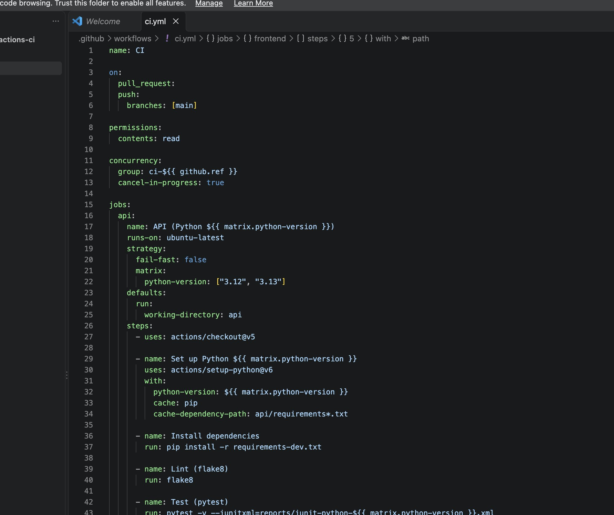
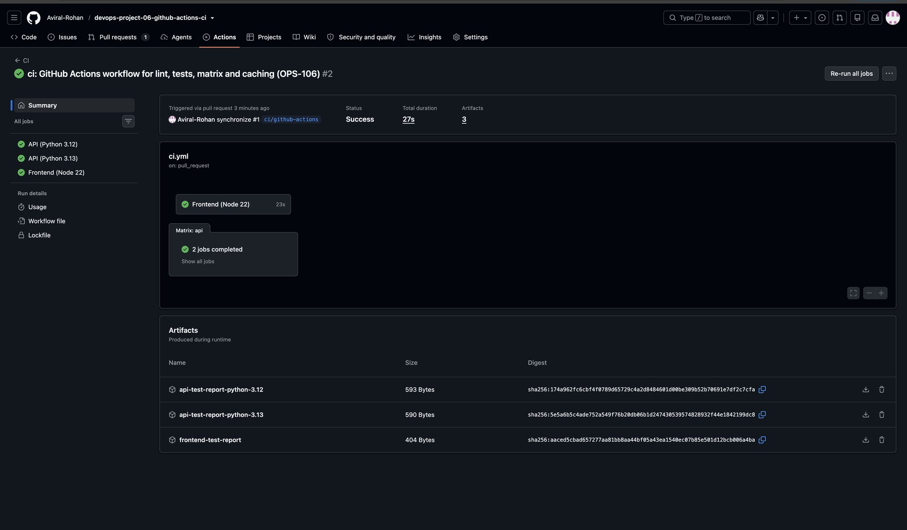
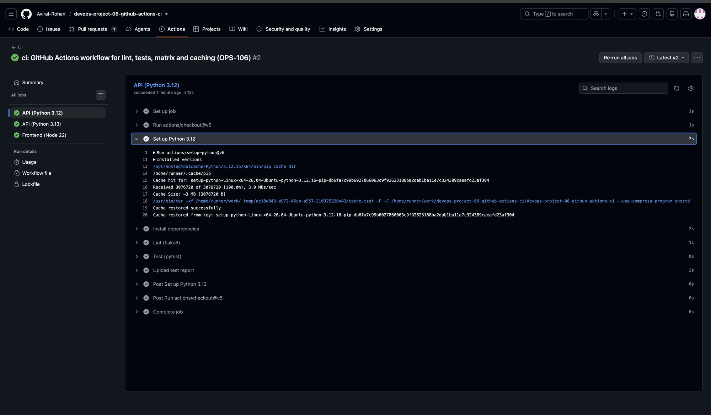
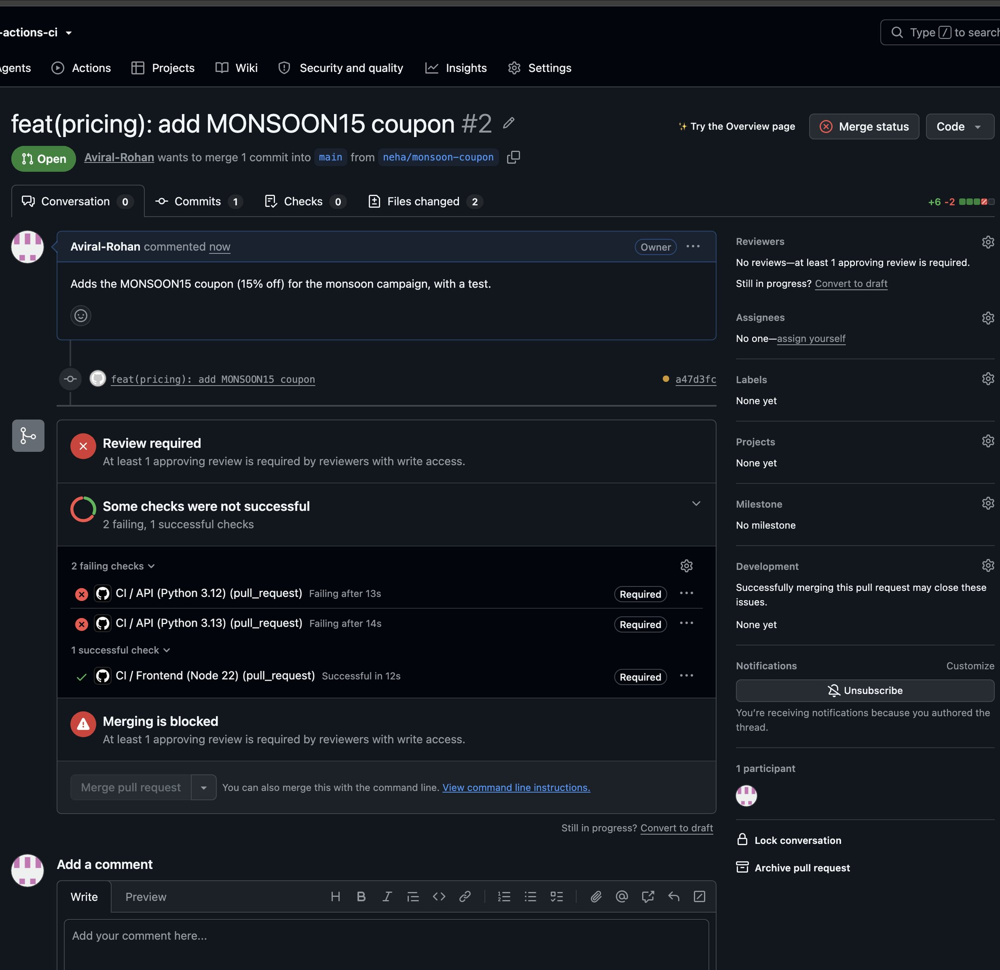
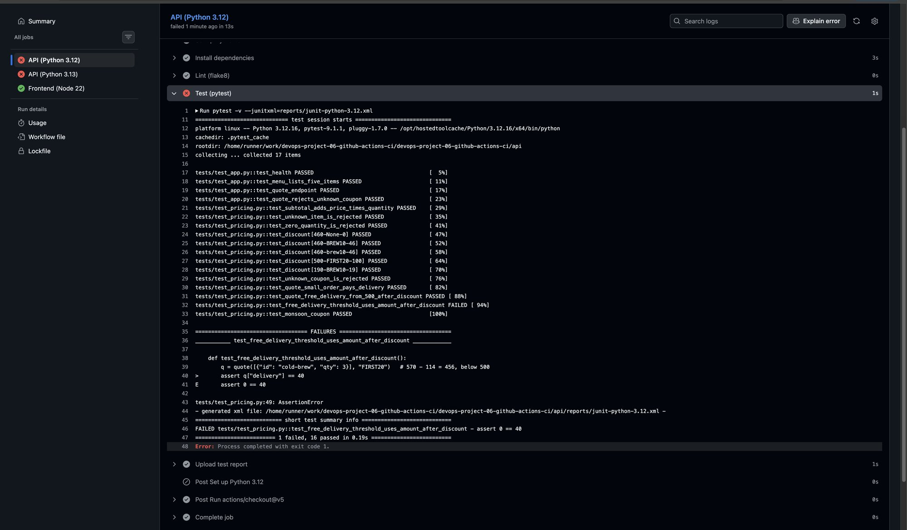
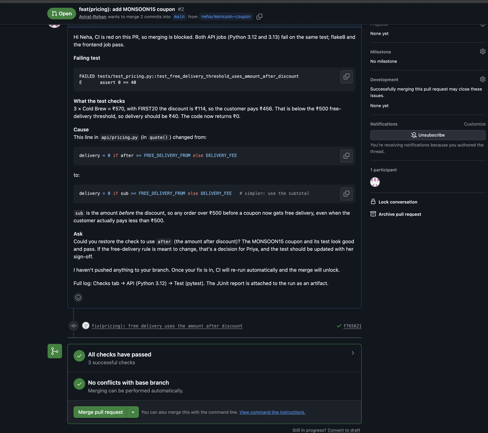

# Project 06: Continuous Integration with GitHub Actions

[](https://github.com/Aviral-Rohan/devops-project-06-github-actions-ci/actions/workflows/ci.yml)

**Real-World DevOps Projects** · Part 6 of 20 · Phase 2: Delivery · Rohan Aviral

> **Ticket OPS-106 from Arjun (Senior DevOps).** Twice this month broken code reached main. Every pull request must be linted and tested automatically, and a failing check must block the merge.

This repo is **BrewCart**, a small coffee-ordering app: a Flask API with the pricing rules (`api/pricing.py`) and an Express frontend. I wrote the CI workflow from an empty file. It lints and tests both apps on every pull request, runs the API tests on two Python versions, caches dependencies, keeps the test reports, and `main` is protected so a red check blocks the merge. Then a teammate's pull request with a pricing bug arrived, and the pipeline stopped it.

📄 Full step-by-step write-up with screenshots: **[Project_06_GitHub_Actions_CI.pdf](https://github.com/Aviral-Rohan/devops-project-06-github-actions-ci/releases/download/v1.0.0/Project_06_GitHub_Actions_CI.pdf)** (attached to the v1.0.0 release)
🏷️ Release: [v1.0.0: CI on every pull request](https://github.com/Aviral-Rohan/devops-project-06-github-actions-ci/releases/tag/v1.0.0)
⬅️ Previous: [Project 05, Python Ops Automation](https://github.com/Aviral-Rohan/devops-project-05-python-ops-automation) · ➡️ Next: Project 07, Build, Scan and Publish Images in CI

---

## In plain words

Before, "did anyone run the tests?" depended on memory. Now a **robot checks every change** before it can join the main code.

- **Every pull request gets checked.** GitHub starts a fresh Linux machine, installs the app, runs the style checker and the tests, then throws the machine away.
- **Two Python versions at once.** The API is tested on Python 3.12 and 3.13 side by side, so an upgrade can't surprise us.
- **Faster second time.** Downloaded packages are kept (cached), so the next run doesn't download them again.
- **Receipts.** Each run keeps its test reports, even when tests fail, so anyone can see what happened.
- **A locked door.** `main` only accepts a change when all three checks are green. Nobody can skip it, including the admin.
- **The robot doesn't fix code, it reports.** When Neha's change broke a pricing rule, I told her which test failed and why. She fixed her own branch, the checks went green, and only then was it merged.

---

## How our CI works

Every pull request, and every push to `main`, runs [`.github/workflows/ci.yml`](.github/workflows/ci.yml) on GitHub-hosted Ubuntu runners:

| Job | Steps |
|---|---|
| API (Python 3.12) and API (Python 3.13) | install → `flake8` → `pytest` → upload JUnit report |
| Frontend (Node 22) | `npm ci` → `npm run lint` (eslint) → `npm test` (node --test) → upload JUnit report |

- The jobs run in parallel. The API job runs once per Python version (a matrix, `fail-fast: false`, so one version failing doesn't cancel the other).
- pip and npm downloads are cached, keyed on `api/requirements*.txt` and `frontend/package-lock.json`.
- Test reports are attached to every run as artifacts (`if: always()`), even when tests fail.
- `main` is protected: all three checks must pass before a pull request can be merged.
- `permissions: contents: read`: the workflow's token can only read the repo.
- `concurrency` cancels an older run on the same branch when a newer commit is pushed.

If a check fails, open the pull request → **Details** next to the red check → expand the step with ❌ and read its last lines.

## Run the checks locally

```bash
cd api && pip install -r requirements-dev.txt && flake8 && pytest
cd frontend && npm ci && npm run lint && npm test
```

---

## The workflow, part by part

```yaml
on:
  pull_request:            # every PR, any branch
  push:
    branches: [main]       # and every merge into main
```

| Part | Why it's there |
|---|---|
| `permissions: contents: read` | Least privilege: CI only needs to read the code |
| `concurrency: group: ci-${{ github.ref }}` + `cancel-in-progress: true` | Two quick pushes don't waste two runs |
| `name: API (Python ${{ matrix.python-version }})` | This name is what branch protection requires, so it must stay stable |
| `strategy.matrix.python-version: ["3.12", "3.13"]` | One job definition, two parallel jobs |
| `defaults.run.working-directory: api` | Every `run:` step starts inside `api/` |
| `actions/checkout@v5` | Copies the repo onto the runner |
| `actions/setup-python@v6` with `cache: pip` | Installs Python and restores the pip download cache |
| `actions/setup-node@v5` with `cache: npm` | Same for Node 22 and npm |
| `pytest --junitxml=reports/...` / `node --test --test-reporter=junit` | Machine-readable test reports |
| `if: always()` + `actions/upload-artifact@v6` | Keep the report even when tests fail, which is exactly when you need it |



## Results

| Check | Result |
|---|---|
| PR #1 (the workflow itself) | 3 checks green: API 3.12 (11 s), API 3.13 (15 s), Frontend (11 s) |
| Whole run | 18 s, 3 test-report artifacts |
| Node 20 deprecation warnings | 3 → **0** after moving `upload-artifact` from v5 to v6 |
| Branch protection | 3 required checks, no bypass |
| Neha's PR #2 | **Blocked**: 2 failing checks, "Merging is blocked" |
| After Neha's fix | 3 checks green, 17 tests passed, merged |
| Badge on `main` | **passing** |



### Caching: measured, not assumed

| Measurement | Cache miss (first run) | Cache hit |
|---|---|---|
| `pip install`, Python 3.12 | 5 s | 3 s |
| `pip install`, Python 3.13 | 4 s | 3 s |
| `npm ci` | 1 s | 2 s |
| Set up Node step (includes the cache restore) | 1 s | 8 s |

The first run logged `pip cache is not found`; the re-run logged `Cache restored successfully`. The pip cache saves about 1–2 s per job. For the frontend's handful of npm packages, restoring the cache took **longer** than just downloading them. The cache will pay off as the dependency list grows. On a project this size it's a wash, and I'd rather report that than claim a speed-up that isn't there.



---

## The twist: Neha's pull request

Neha opened **PR #2**, adding a `MONSOON15` coupon. While there she "simplified" one line in `api/pricing.py`:

```diff
-    delivery = 0 if after >= FREE_DELIVERY_FROM else DELIVERY_FEE
+    delivery = 0 if sub >= FREE_DELIVERY_FROM else DELIVERY_FEE   # simpler: use the subtotal
```

Both API jobs went red and the merge button locked:

```
FAILED tests/test_pricing.py::test_free_delivery_threshold_uses_amount_after_discount
E       assert 0 == 40
```

**Why it matters:** 3 × Cold Brew = ₹570. With FIRST20 the discount is ₹114, so the customer pays ₹456. That's below the ₹500 free-delivery threshold, so delivery should cost ₹40. With `sub` (the amount before discount), every discounted order over ₹500 would ship free: lost revenue on every coupon order.



**What I did, and didn't do.** The bug is application logic, so it's Neha's to fix. I didn't push to her branch. I left a review comment with:

1. the exact failing test and assertion,
2. the numbers that make the expected value right,
3. the line that changed, before and after,
4. the ask (restore `after`), noting that her coupon itself was fine and that any change to the delivery rule is Priya's decision.

Neha pushed `fix(pricing): free delivery uses the amount after discount`. CI re-ran by itself, all 3 checks went green, and the PR was merged.




---

## What's inside

```
devops-project-06-github-actions-ci/
├── .github/workflows/ci.yml   # lint + test, matrix, caching, test-report artifacts
├── api/
│   ├── app.py                 # Flask: /health, /menu, POST /quote
│   ├── pricing.py             # menu, coupons, GST, delivery rules
│   ├── tests/                 # pytest (17 tests)
│   ├── requirements.txt / requirements-dev.txt
│   └── .flake8
├── frontend/
│   ├── server.js              # Express
│   ├── test/server.test.js    # node:test
│   ├── eslint.config.js
│   └── package.json / package-lock.json
└── docs/
    ├── ci-cheatsheet.md       # workflow syntax and commands used in this project
    └── screenshots/
```

## Problems I hit

| Problem | Cause | Fix |
|---|---|---|
| `node` crashed: `dyld: Library not loaded: libllhttp.9.3.dylib` | Homebrew's Node 25 and its llhttp library were out of sync on an Intel Mac (no pre-built bottles) | Removed Homebrew Node and installed Node 22 with **nvm**, matching CI |
| 3 "Node.js 20 is deprecated" annotations on every run | `actions/upload-artifact@v5` runs on Node 20 | Upgraded to `@v6` (Node 24): 0 annotations |
| Couldn't find the run's Summary page | It's not on the PR page | **Actions** tab → the run → **Summary** (top of the left list) |
| Required approvals would block every merge | I'm the only person on the repo, and GitHub doesn't let you approve your own PR | Unticked "Require approvals". The required checks are the gate, and "Do not allow bypassing" stays on |
| `@Neha` in my review turned into a link | `@name` pings a real GitHub user with that name | Edited to "Hi Neha," without the `@` |
| npm "cache hit" was slower than a miss | Restoring a cache has a fixed cost; there are only a few npm packages | Kept it (it will pay off as dependencies grow) and reported the real numbers |

## What I learned

- CI is a contract: the check **names** are what branch protection requires, so keep job names stable.
- A matrix turns one job definition into parallel jobs; `fail-fast: false` keeps them independent.
- Upload reports with `if: always()`. A failed run is when you need them most.
- Measure caching; don't assume it. Small dependency sets can be slower from cache.
- Required checks plus "no bypass" means even an admin can't merge red code.
- When CI catches someone else's bug, give them the log line, the reason and the ask. Don't silently fix it on their branch.
- Pin action versions and read the annotations; deprecation warnings become failures later.

## License

MIT. BrewCart and the team members named here are fictional, for training.
